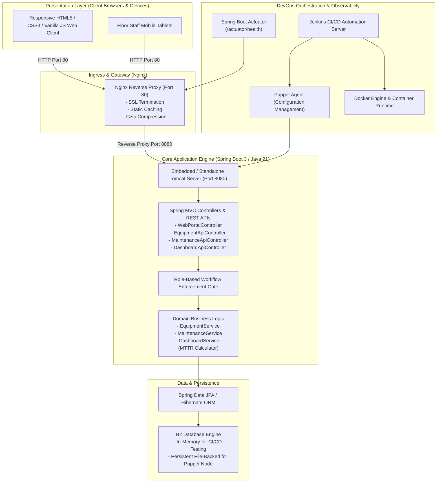
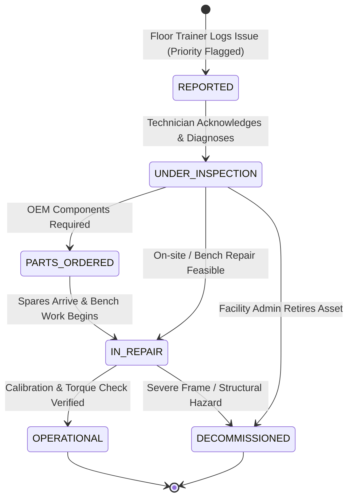

# Puppet-Provisioned Fitness Equipment Maintenance Portal

[](https://www.oracle.com/java/)
[](https://spring.io/projects/spring-boot)
[](https://maven.apache.org/)
[](https://www.selenium.dev/)
[](https://www.docker.com/)
[](https://www.puppet.com/)
[](https://www.jenkins.io/)
[](#test-automation--quality-assurance)

> An end-to-end DevOps and full-stack software engineering platform for commercial gym facilities, recreation clubs, and fitness centers. Features automated breakdown incident logging, role-governed remediation workflows, real-time Mean Time to Repair (MTTR) analytics, headless Selenium browser test automation with failure screenshots, declarative Jenkins CI/CD pipelines, multi-stage Docker containerization, and idempotent Puppet infrastructure provisioning.

---

## Architecture Overview



---

## 15-Task Complete Deliverables Index

Detailed, standalone documentation and execution artifacts are available in the [`docs/`](docs/) directory:

1. [**01. Problem Definition, Stakeholders, Objectives & MVP Scope**](docs/01_PROBLEM_DEFINITION_AND_SCOPE.md)
   * Real-time industry need, user personas, existing operational pain points, stakeholder register, success criteria, and frozen 15-Task MVP scope.
2. [**02. Agile Planning & DevOps Workflow**](docs/02_AGILE_DEVOPS_WORKFLOW.md)
   * User stories with Given-When-Then acceptance criteria, product backlog (Fibonacci story points), 15-Task Kanban board, Definition of Done, and end-to-end DevOps lifecycle diagram.
3. [**03. Requirements, Architecture & Technology Setup**](docs/03_SRS_ARCHITECTURE_DESIGN.md)
   * Software Requirements Specification (SRS), use-case diagram, system architecture, Entity-Relationship data model, REST API catalogue, and local setup guide.
4. [**04. Git & GitHub Repository Strategy**](docs/04_GIT_GITHUB_STRATEGY.md)
   * GitFlow branching model (`main`, `dev`, `feature/*`, `bugfix/*`), branch protection policies, GitHub issue templates, and commit guidelines.
5. [**05. Feature Development with Branching Workflow**](docs/05_FEATURE_BRANCHING_EVIDENCE.md)
   * Feature 1 implementation (`feature/equipment-logging`), command log (`add`, `commit`, `push`, `pull`), Pull Request #1 transcript, peer review, and merge evidence.
6. [**06. MVP Completion, Collaboration & Conflict Resolution**](docs/06_MVP_COMPLETION_COLLABORATION.md)
   * Feature 2 implementation (`feature/status-workflow-dashboard`), intentional merge conflict creation on `DashboardService.java`, conflict resolution, and release tagging (`v1.0.0-mvp`).
7. [**07. Jenkins CI Installation & Continuous Integration Job**](docs/07_JENKINS_CI_JOB.md)
   * Jenkins server setup, GitHub SCM trigger (`H/5 * * * *`), Maven build execution log, and archived build artifact (`fitness-equipment-portal.jar`).
8. [**08. Pipeline as Code (Jenkinsfile) & Server Deployment**](docs/08_PIPELINE_AS_CODE_DEPLOYMENT.md)
   * Declarative 9-stage `Jenkinsfile`, multi-environment parameterization (`ENVIRONMENT`, `APP_PORT`, `DEPLOY_TARGET`), and live health check verification.
9. [**09. Selenium WebDriver Test Automation**](docs/09_SELENIUM_TEST_AUTOMATION.md)
   * 3 critical user journeys in headless Chrome, JUnit 5 test architecture, automatic failure screenshot watcher (`target/screenshots/`), and Maven test logs.
10. [**10. Continuous Testing & Defect Quality Gate**](docs/10_CONTINUOUS_TESTING_DEFECT_LIFECYCLE.md)
    * Quality gate stopping deployment on failed tests, deliberately introduced UI defect scenario, failed pipeline log, defect correction commit, and successful rerun.
11. [**11. Docker Image & Container Lifecycle**](docs/11_DOCKER_CONTAINER_LIFECYCLE.md)
    * Multi-stage Dockerfile, image layer analysis, port mapping (8080:8080), lifecycle operations (`run`, `logs`, `inspect`, `healthcheck`, `stop`, `restart`, `rm`).
12. [**12. Jenkins-Docker Continuous Deployment Pipeline**](docs/12_JENKINS_DOCKER_CD_PIPELINE.md)
    * Commit-to-container automated deployment, versioned tagging `1.0.${BUILD_NUMBER}`, container rollover, and health check validation.
13. [**13. Puppet Configuration Management Specification & Manifests**](docs/13_PUPPET_CONFIGURATION_MANAGEMENT.md)
    * Server prerequisite codification (packages, users, folders, systemd, Nginx), Puppet module structure (`site.pp`, `init.pp`, `install.pp`, `config.pp`, `service.pp`), and first execution log.
14. [**14. Automated Provisioning, Idempotency & Rollback Validation**](docs/14_AUTOMATED_PROVISIONING_IDEMPOTENCY_ROLLBACK.md)
    * Clean target node provisioning, idempotency proof (second run exit code 0, 0 changes), live health check, and automated rollback demonstration.
15. [**15. DevOps Verification & Traceability Matrix**](docs/15_DEVOPS_VERIFICATION_MATRIX.md)
    * Traceability matrix connecting all 15 tasks to source code, configs, test suites, and deliverables.

---

## Role-Based Remediation Workflow



---

## Quick Start & Local Execution

### 1. Prerequisites
* **Java 21 LTS** (`java -version`)
* **Apache Maven 3.9+** (`mvn -version`)
* **Google Chrome / Chromium / Edge** (for headless Selenium tests)

### 2. Build & Execute Full Test Suite
```bash
# Execute all 15 unit, API, JPA, and headless Selenium tests
mvn clean test
```

### 3. Run Application Locally
```bash
# Using Maven Spring Boot Plugin
mvn spring-boot:run

# Or run helper scripts
# Windows:
scripts\run_local.bat
# Linux / macOS:
chmod +x scripts/run_local.sh && ./scripts/run_local.sh
```

### 4. Interactive URLs
* **Web Command Center**: [http://localhost:8080/](http://localhost:8080/)
* **Equipment Inventory**: [http://localhost:8080/equipment](http://localhost:8080/equipment)
* **Maintenance Workflow**: [http://localhost:8080/maintenance](http://localhost:8080/maintenance)
* **Executive KPI Dashboard**: [http://localhost:8080/dashboard](http://localhost:8080/dashboard)
* **H2 Database Console**: [http://localhost:8080/h2-console](http://localhost:8080/h2-console) (JDBC URL: `jdbc:h2:mem:fitnessdb`, User: `sa`, Password: `password`)
* **Health API Endpoint**: [http://localhost:8080/api/dashboard/health](http://localhost:8080/api/dashboard/health)

---

## Docker Containerization

### Build & Run Container
```bash
# Build multi-stage optimized image
docker build -t fitnessequipment/portal:1.0.0 -t fitnessequipment/portal:latest .

# Run with port mapping
docker run -d --name fitness-portal-app -p 8080:8080 fitnessequipment/portal:1.0.0

# Verify health status
docker inspect --format='{{json .State.Health.Status}}' fitness-portal-app
# Output: "healthy"
```

### Docker Compose
```bash
docker-compose up -d
```

---

## Puppet Configuration Management

### Apply Module Manifests
```bash
# Copy modules into Puppet environment
sudo cp -r puppet/modules/fitness_portal /etc/puppetlabs/code/environments/production/modules/
sudo cp puppet/manifests/site.pp /etc/puppetlabs/code/environments/production/manifests/

# Execute puppet apply
sudo puppet apply --detailed-exitcodes /etc/puppetlabs/code/environments/production/manifests/site.pp

# Verify idempotency (rerun returns exit code 0)
sudo puppet apply --detailed-exitcodes /etc/puppetlabs/code/environments/production/manifests/site.pp
echo "Exit code: $?" # 0
```

---

## Repository Structure

```
Fitness_-equipment-/
├── .github/
│   ├── ISSUE_TEMPLATE/
│   │   ├── bug_report.md
│   │   └── feature_request.md
├── .gitignore
├── README.md
├── Jenkinsfile
├── Dockerfile
├── docker-compose.yml
├── pom.xml
├── src/
│   ├── main/
│   │   ├── java/com/fitnessequipment/portal/
│   │   │   ├── FitnessEquipmentApplication.java
│   │   │   ├── model/ (Equipment, MaintenanceLog, Enums)
│   │   │   ├── repository/ (EquipmentRepository, MaintenanceLogRepository)
│   │   │   ├── service/ (EquipmentService, MaintenanceService, DashboardService)
│   │   │   ├── controller/ (API & Web MVC Controllers)
│   │   │   ├── dto/ (DashboardSummaryDto, Request DTOs)
│   │   │   └── config/ (DataInitializer, Seed Data)
│   │   └── resources/
│   │       ├── application.properties
│   │       ├── static/ (css/styles.css, js/app.js)
│   │       └── templates/ (index.html, equipment-list.html, etc.)
│   └── test/
│       ├── java/com/fitnessequipment/portal/
│       │   ├── FitnessEquipmentApplicationTests.java
│       │   ├── service/ (Equipment & Maintenance Service Tests)
│       │   ├── api/ (MockMvc REST Endpoint Tests)
│       │   └── selenium/ (BaseSeleniumTest, Watcher, 3 User Journey Tests)
│       └── resources/ (application-test.properties)
├── puppet/
│   ├── manifests/site.pp
│   └── modules/fitness_portal/
│       ├── manifests/{init,install,config,service}.pp
│       ├── files/nginx_reverse_proxy.conf
│       └── templates/{fitness-portal.service.erb, application.properties.erb}
├── ansible/
│   ├── inventory.ini
│   └── playbook.yml
├── scripts/
│   ├── run_local.bat
│   ├── run_local.sh
│   ├── run_selenium_tests.bat
│   ├── docker_lifecycle.sh
│   └── puppet_provision.sh
└── docs/
    ├── 01_PROBLEM_DEFINITION_AND_SCOPE.md
    ├── 02_AGILE_DEVOPS_WORKFLOW.md
    ├── 03_SRS_ARCHITECTURE_DESIGN.md
    ├── 04_GIT_GITHUB_STRATEGY.md
    ├── 05_FEATURE_BRANCHING_EVIDENCE.md
    ├── 06_MVP_COMPLETION_COLLABORATION.md
    ├── 07_JENKINS_CI_JOB.md
    ├── 08_PIPELINE_AS_CODE_DEPLOYMENT.md
    ├── 09_SELENIUM_TEST_AUTOMATION.md
    ├── 10_CONTINUOUS_TESTING_DEFECT_LIFECYCLE.md
    ├── 11_DOCKER_CONTAINER_LIFECYCLE.md
    ├── 12_JENKINS_DOCKER_CD_PIPELINE.md
    ├── 13_PUPPET_CONFIGURATION_MANAGEMENT.md
    ├── 14_AUTOMATED_PROVISIONING_IDEMPOTENCY_ROLLBACK.md
    └── 15_DEVOPS_VERIFICATION_MATRIX.md
```

---

## License & Attribution
Developed for the **Puppet-Provisioned Fitness Equipment Maintenance Portal** project. Licensed under the MIT License.