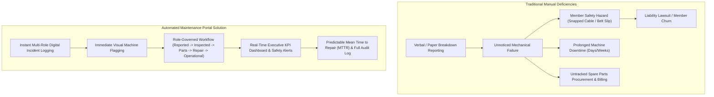
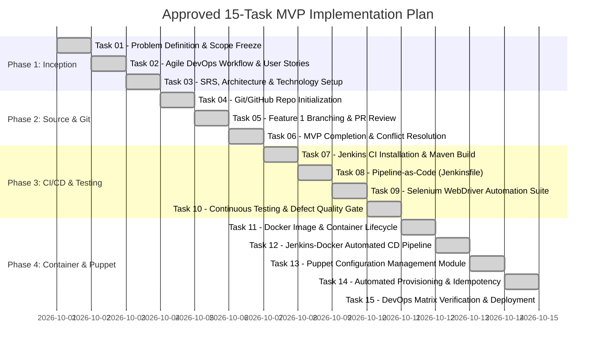

# 01. Problem Definition, Stakeholders, Objectives and MVP Scope

## 1. Executive Summary & Real-Time Industry Need
Modern fitness centers, commercial health clubs (e.g., Equinox, Anytime Fitness, Planet Fitness), and collegiate recreation complexes house hundreds of high-utilization electromechanical machines (motorized treadmills, electromagnetic resistance ellipticals, pneumatic cable cross towers, selectorized weight stacks, and spin bikes).

In standard gym operations, equipment failures are handled through ad-hoc, informal mechanisms:
* A fitness trainer notices a fraying cable or loose treadmill belt and verbally mentions it to front-desk staff.
* Gym members encounter an inoperable machine with an error code, abandon their workout in frustration, and leave the unit unmarked.
* Technicians lack centralized tracking for spare parts, work order history, manufacturer warranty deadlines, and mean time to repair (MTTR).
* Management faces unquantifiable revenue loss due to member dissatisfaction, safety hazards leading to legal liabilities (e.g., snapped cables under load), and lack of preventive audit trails.

The **Fitness Equipment Maintenance Portal** solves this operational bottleneck by providing an automated, real-time maintenance and asset-lifecycle platform.

---

## 2. Target Users & Personas

| User Persona | Role | Key Responsibilities & Daily Tasks |
| :--- | :--- | :--- |
| **Fitness Floor Staff / Trainer** | Reporter | Observes degraded machines during floor rounds or training sessions. Submits quick-response breakdown tickets with priority flags. |
| **Maintenance Technician** | Remediator | Diagnoses mechanical and electrical faults. Transitions tickets through inspection, parts procurement, and repair. Records diagnostic notes and labor/spares costs. |
| **Gym Operations Manager** | Supervisor | Monitors fleet availability, SLA compliance, pending work orders, and technician workload. Authorizes external component purchases. |
| **Facility Admin / Director** | Executive & Compliance | Evaluates fleet reliability, MTTR trends, manufacturer warranty claims, equipment replacement schedules, and decommissions hazardous assets. |

---

## 3. Existing Pain Points & Gaps

---

## 4. Stakeholder Register

1. **Gym Members / Athletes**: Demand uninterrupted access to safe, calibrated equipment.
2. **Floor Trainers & Instructors**: Need a 30-second mobile-friendly submission flow to flag equipment issues without leaving the floor.
3. **Certified Maintenance Technicians**: Require diagnostic history, part numbers, and clear lifecycle status transitions.
4. **Operations & Facility Managers**: Require real-time KPI metrics on equipment uptime by gym zone.
5. **Equipment Vendors & OEMs (LifeFitness, Matrix, Concept2, Hammer Strength)**: Depend on precise failure telemetry and warranty logs.
6. **OSHA & Health/Safety Compliance Auditors**: Require immutable digital logs proving scheduled safety inspections were conducted.

---

## 5. Constraints

* **Operational Friction**: Floor staff will not adopt complex enterprise software during gym floor hours; ticket logging must require $< 4$ form fields.
* **Network Intermittency**: Basement and reinforced concrete gym rooms often have weak Wi-Fi; UI must be lightweight and fault-tolerant.
* **Role-Based Safety Governance**: Non-technicians must never be able to mark a damaged machine as "Operational" or "Decommissioned".
* **Deployment Portability**: Solution must run predictably in Docker containers, on bare-metal Linux servers provisioned via Puppet, and on Tomcat/Nginx stacks.

---

## 6. Measurable Success Criteria

* **Mean Time to Log (MTTL)**: Reduction of breakdown logging latency from an average of 4.2 hours to $< 60$ seconds.
* **Fleet Availability**: Increase gym equipment fleet operational uptime to $\ge 96.5\%$.
* **Mean Time to Repair (MTTR)**: Tracking and reducing average repair turnaround from 72 hours to $< 24$ hours.
* **Safety Audit Compliance**: $100\%$ digital traceability for equipment inspections and safety hazard reports.
* **Page Response Time**: Sub-2-second server rendering and API response times under standard operational load.

---

## 7. Approved 15-Task MVP Scope

| Task # | Task Title | Primary Deliverable |
| :---: | :--- | :--- |
| **01** | Problem Definition & Scope | Problem statement, stakeholder register, success criteria, frozen scope |
| **02** | Agile Planning & DevOps Workflow | User stories, acceptance criteria, Kanban board, DoD, DevOps diagram |
| **03** | Requirements & System Architecture | SRS summary, use-case diagram, architecture diagram, REST APIs, local setup |
| **04** | Git & GitHub Initialization | GitHub repository baseline, README, `.gitignore`, issue templates, branch policies |
| **05** | Feature Development on Branch | Feature branch `feature/equipment-logging`, commit logs, PR, code review |
| **06** | MVP Completion & Conflict Resolution | Merge conflict creation and rebase resolution, `v1.0.0-mvp` release tag |
| **07** | Jenkins CI Job Configuration | Jenkins Maven build job, SCM trigger, artifact archiving (`.jar`) |
| **08** | Pipeline as Code (Jenkinsfile) | Declarative Jenkinsfile with multi-environment parameters & stages |
| **09** | Selenium Test Design & Execution | 3-5 headless browser user journeys with automated failure screenshot watcher |
| **10** | Continuous Testing in Jenkins | Test gatekeeper blocking deployment on failure, defect correction rerun |
| **11** | Docker Image & Lifecycle | Multi-stage Dockerfile, image layering, port mapping, lifecycle operations |
| **12** | Jenkins-Docker CD Pipeline | Commit-to-container automated deployment with health checks |
| **13** | Puppet Configuration Management | Puppet manifests (`site.pp`, `init.pp`, `install.pp`, `config.pp`, `service.pp`) |
| **14** | Automated Provisioning & Idempotency | Target node configuration, idempotency execution proof, recovery/rollback |
| **15** | DevOps Verification & Delivery | End-to-end verification matrix, documentation consolidation, repository sync |
