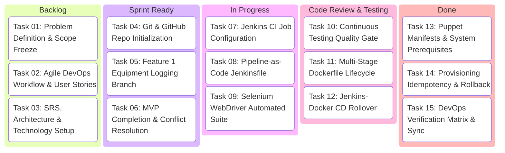
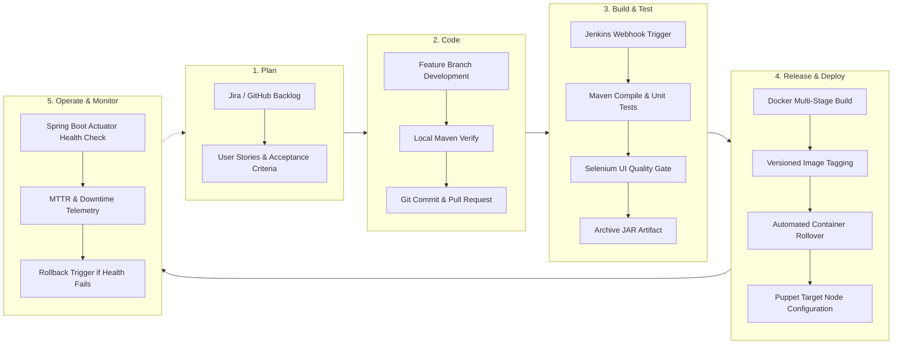

# 02. Agile Planning and DevOps Workflow

## 1. User Stories & Acceptance Criteria

### Story US-01: Quick Breakdown Reporting by Floor Staff
* **As a** Fitness Trainer or Floor Staff member,
* **I want to** report a malfunctioning machine in under 30 seconds by selecting the unit and priority,
* **So that** members are protected from injury and technicians are instantly alerted.

> **Scenario 1: Successful Breakdown Submission**
> * **Given** an operational machine exists in the database with serial number `"TM-2024-001"`,
> * **When** the trainer selects the machine, enters the issue description `"Belt slipping during sprint"`, selects priority `"HIGH"`, and submits the form,
> * **Then** a new maintenance ticket should be persisted with status `"REPORTED"`,
> * **And** the parent equipment status must automatically update to `"REPORTED"` on the inventory board.

> **Scenario 2: Validation of Mandatory Fields**
> * **Given** the breakdown modal is open,
> * **When** the user clicks "Submit Ticket" without selecting an equipment unit or entering a title,
> * **Then** client and server-side validation must block submission with an HTTP 400 response.

---

### Story US-02: Technician Workflow Progression
* **As a** Certified Maintenance Technician,
* **I want to** transition tickets through the diagnostic and repair lifecycle,
* **So that** all stakeholders know if parts are ordered or if bench repairs are ongoing.

> **Scenario 1: Transitioning from Inspected to Parts Ordered**
> * **Given** ticket #2 is currently in `"UNDER_INSPECTION"` status,
> * **When** the technician selects target status `"PARTS_ORDERED"`, adds technician notes `"Ordered OEM belt #LT-502"`, and enters estimated cost `$120.00`,
> * **Then** the ticket and machine status must update to `"PARTS_ORDERED"`,
> * **And** the transition timestamp and notes must be appended to the resolution audit log.

> **Scenario 2: Successful Repair & Recommissioning**
> * **Given** ticket #2 is currently in `"IN_REPAIR"` status,
> * **When** the technician updates status to `"OPERATIONAL"`, enters actual cost `$115.50`, and completes torque verification,
> * **Then** the ticket must record `resolvedAt` timestamp,
> * **And** the machine's `lastInspectionDate` must update to today's date.

---

### Story US-03: Real-Time Executive KPI Dashboard
* **As a** Gym Operations Manager,
* **I want to** view live fleet statistics, zone-by-zone distribution, and average Mean Time to Repair (MTTR),
* **So that** I can assess gym floor readiness and allocate maintenance budgets.

> **Scenario 1: Real-time Metric Aggregation**
> * **Given** the database contains 8 registered units (5 operational, 1 inspected, 1 parts ordered, 1 in repair),
> * **When** the manager opens `/dashboard` or queries `/api/dashboard/summary`,
> * **Then** the Total Fleet card must display `8`, Operational Uptime must display `5`, Active Breakdowns must display `3`,
> * **And** MTTR must calculate the historical turnaround average in hours.

---

## 2. Product Backlog & Story Point Estimation (Fibonacci Scale)

| Backlog ID | Feature / User Story | Priority | Story Points | Sprint Target |
| :---: | :--- | :---: | :---: | :---: |
| **PB-01** | Equipment Entity Model & H2 Schema Setup | Highest | 3 | Sprint 1 |
| **PB-02** | Maintenance Incident Reporting REST API | Highest | 5 | Sprint 1 |
| **PB-03** | Responsive Breakdown Modal & Web UI View | High | 5 | Sprint 1 |
| **PB-04** | Role-Based Workflow State Transition Engine | Highest | 8 | Sprint 1 |
| **PB-05** | Real-Time Executive KPI Calculation Service | High | 5 | Sprint 1 |
| **PB-06** | Fleet Search & Multi-Criteria Zone Filter | Medium | 3 | Sprint 2 |
| **PB-07** | Automated Selenium Headless Test Journeys | High | 8 | Sprint 2 |
| **PB-08** | JUnit 5 Screenshot Watcher on Test Failure | Medium | 3 | Sprint 2 |
| **PB-09** | Declarative Jenkins CI/CD Pipeline | Highest | 8 | Sprint 2 |
| **PB-10** | Continuous Testing Gate in Jenkinsfile | High | 5 | Sprint 2 |
| **PB-11** | Multi-Stage Hardened Dockerfile Containerization | High | 5 | Sprint 3 |
| **PB-12** | Container Registry Tagging & Rollover Script | Medium | 3 | Sprint 3 |
| **PB-13** | Puppet Target Node Manifests & Systemd Service | Highest | 8 | Sprint 3 |
| **PB-14** | Automated Idempotency & Rollback Demonstration | High | 5 | Sprint 3 |
| **PB-15** | Comprehensive Documentation & Git Repository Sync | High | 3 | Sprint 3 |

---

## 3. 15-Task Kanban Board Plan

---

## 4. Definition of Done (DoD) Checklist

For any feature or DevOps task to be marked **DONE**, the following criteria must be satisfied:
* [x] **Source Code**: Clean, well-structured Java 21 / Spring Boot code adhering to OOP conventions and Clean Code principles.
* [x] **Automated Testing**: Unit and Integration test coverage using JUnit 5 and MockMvc; zero test regressions.
* [x] **End-to-End Testing**: Selenium WebDriver user journeys verified in headless Chrome/Edge.
* [x] **Quality Gate**: Maven compile, build, and test steps pass without warnings or failures.
* [x] **Containerization**: Passes multi-stage Docker build; container exposes health check and runs under non-root user `fitnessapp`.
* [x] **Infrastructure as Code**: Configuration scripts (Puppet / Ansible) are idempotent (0 changes on second execution).
* [x] **Documentation**: Full Markdown documentation with embedded Mermaid diagrams and exact execution logs.
* [x] **Version Control**: Changes committed on feature branches, reviewed, merged, and tagged (`v1.0.0-mvp`).

---

## 5. End-to-End DevOps Lifecycle Workflow

