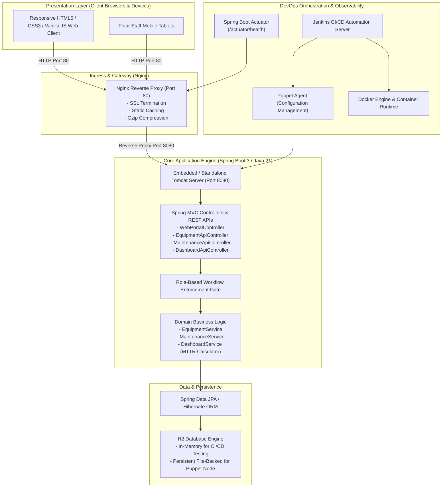
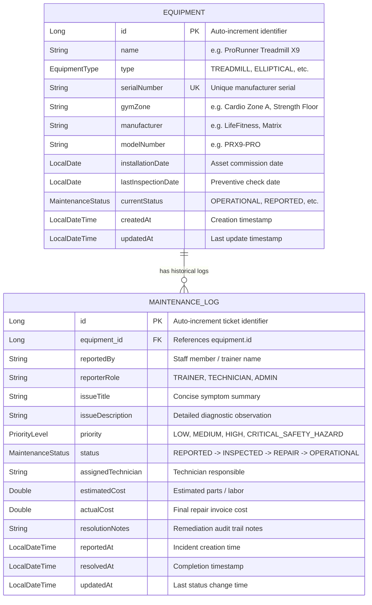

# 03. Requirements, Architecture and Technology Setup

## 1. Software Requirements Specification (SRS) Summary

### 1.1 Functional Requirements (FR)
* **FR-01: Asset Registration & Cataloging**: System must allow adding, updating, viewing, and deleting fitness equipment with unique serial numbers, manufacturer, model, gym zone, and installation date.
* **FR-02: Maintenance Incident Logging**: Floor trainers and staff must be able to log equipment defects with title, description, and priority level (`LOW`, `MEDIUM`, `HIGH`, `CRITICAL_SAFETY_HAZARD`).
* **FR-03: Role-Governed Lifecycle Workflow**: Maintenance tickets must progress through a 5-stage pipeline: `REPORTED` &rarr; `UNDER_INSPECTION` &rarr; `PARTS_ORDERED` &rarr; `IN_REPAIR` &rarr; `OPERATIONAL` / `DECOMMISSIONED`. Non-admin roles are restricted from decommissioning assets.
* **FR-04: Multi-Parameter Search & Filter**: Users can filter equipment inventory by equipment type, operational status, gym zone, or search query string.
* **FR-05: Executive Reliability Dashboard**: System computes and renders real-time metrics: Total Fleet Units, Operational Units, Active Breakdowns, Safety Hazard Count, and Mean Time to Repair (MTTR) in hours.
* **FR-06: System Health Check**: Actuator endpoint `/actuator/health` and `/api/dashboard/health` must return `UP` status for automated orchestrators and reverse proxies.

### 1.2 Non-Functional Requirements (NFR)
* **NFR-01: Availability & Portability**: Runs seamlessly inside lightweight Docker containers or on Linux nodes provisioned via Puppet.
* **NFR-02: Performance**: Sub-2-second server rendering for all web views and sub-100ms response for JSON REST APIs under standard operational load.
* **NFR-03: Security & Non-Root Execution**: Runs under restricted OS user `fitnessapp` without root privileges in production.
* **NFR-04: Automated Verification**: 100% of critical user journeys automated via Selenium WebDriver running in headless browser mode.

---

## 2. Use Case Diagram

```mermaid
usecaseDiagram
    actor "Floor Staff / Trainer" as Staff
    actor "Maintenance Technician" as Tech
    actor "Operations Manager" as Manager
    actor "Facility Admin" as Admin

    package "Fitness Equipment Maintenance Portal" {
        usecase "UC-01: Register Equipment Asset" as UC1
        usecase "UC-02: Search & Filter Fleet by Zone/Type" as UC2
        usecase "UC-03: Log Equipment Breakdown Ticket" as UC3
        usecase "UC-04: Diagnose & Transition Workflow" as UC4
        usecase "UC-05: Record Spares Cost & Notes" as UC5
        usecase "UC-06: Decommission Unrepairable Asset" as UC6
        usecase "UC-07: Monitor MTTR & Reliability KPIs" as UC7
        usecase "UC-08: Health Check & Actuator Telemetry" as UC8
    }

    Staff --> UC2
    Staff --> UC3

    Tech --> UC2
    Tech --> UC4
    Tech --> UC5

    Manager --> UC1
    Manager --> UC2
    Manager --> UC3
    Manager --> UC7

    Admin --> UC1
    Admin --> UC6
    Admin --> UC7
    Admin --> UC8
```

---

## 3. High-Level System Architecture



---

## 4. Data Model (Entity-Relationship Diagram)



---

## 5. REST API Specifications

| Method | Endpoint | Description | Request Body / Query Params | Success Response |
| :--- | :--- | :--- | :--- | :--- |
| `GET` | `/api/equipment` | Retrieve all or filtered equipment | `query`, `type`, `status`, `zone` | `200 OK` (JSON Array) |
| `GET` | `/api/equipment/{id}` | Get single equipment asset by ID | Path variable `id` | `200 OK` / `404 Not Found` |
| `GET` | `/api/equipment/by-serial/{sn}` | Lookup machine by serial number | Path variable `sn` | `200 OK` / `404 Not Found` |
| `GET` | `/api/equipment/zones` | Distinct list of gym zones | None | `200 OK` (List of Strings) |
| `POST` | `/api/equipment` | Register new equipment asset | `EquipmentRequestDto` (JSON) | `201 Created` (Equipment JSON) |
| `PUT` | `/api/equipment/{id}` | Update equipment asset | `EquipmentRequestDto` (JSON) | `200 OK` (Equipment JSON) |
| `DELETE`| `/api/equipment/{id}` | Delete equipment asset | Path variable `id` | `204 No Content` |
| `GET` | `/api/maintenance` | Retrieve all maintenance tickets | `status`, `priority` | `200 OK` (List of Logs) |
| `GET` | `/api/maintenance/active` | Active breakdown tickets only | None | `200 OK` (Active Breakdowns) |
| `POST` | `/api/maintenance` | Submit new breakdown report | `MaintenanceRequestDto` (JSON) | `201 Created` (Log JSON) |
| `PATCH`| `/api/maintenance/{id}/workflow` | Transition ticket workflow state | `{status, role, technician, notes, actualCost}` | `200 OK` / `403 Forbidden` |
| `GET` | `/api/dashboard/summary` | Executive KPI analytics metrics | None | `200 OK` (DashboardSummaryDto) |
| `GET` | `/api/dashboard/health` | Application health ping | None | `200 OK` (`{"status":"UP"}`) |

---

## 6. Local Development Setup Guide

### Prerequisites
* Java Development Kit (JDK 21 or higher)
* Apache Maven (3.9.x or higher)
* Modern Web Browser (Chrome, Edge, Firefox)

### Step-by-Step Execution
1. **Clone the repository**:
   ```bash
   git clone https://github.com/manthanrane68-cpu/Fitness_-equipment-.git
   cd Fitness_-equipment-
   ```
2. **Compile and execute automated test suite**:
   ```bash
   mvn clean test
   ```
3. **Run the local application**:
   ```bash
   mvn spring-boot:run
   ```
4. **Access the portal**:
   * Web Portal UI: `http://localhost:8080/`
   * Equipment Fleet: `http://localhost:8080/equipment`
   * Maintenance Workflow: `http://localhost:8080/maintenance`
   * Executive Dashboard: `http://localhost:8080/dashboard`
   * H2 Database Console: `http://localhost:8080/h2-console` (JDBC URL: `jdbc:h2:mem:fitnessdb`, User: `sa`, Password: `password`)
   * Health Endpoint: `http://localhost:8080/api/dashboard/health`
