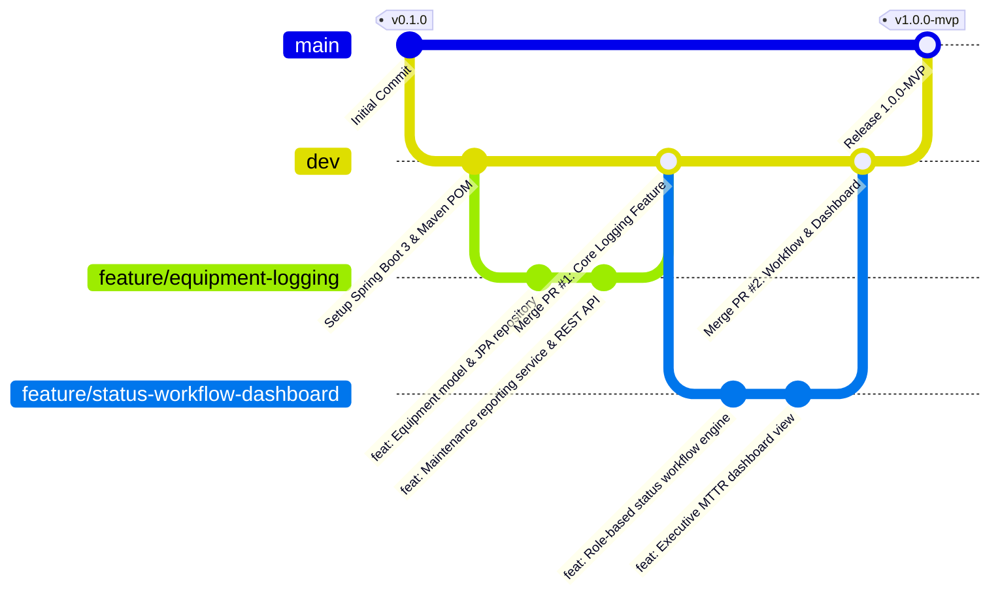

# 04. Git and GitHub Repository Strategy

## 1. Repository Information & URL
* **Target Repository URL**: `https://github.com/manthanrane68-cpu/Fitness_-equipment-.git`
* **Visibility**: Public / Organization
* **Default Trunk Branch**: `main`
* **Development Integration Branch**: `dev`

---

## 2. Branching Model (GitFlow Enhanced)



### Branch Naming Conventions
* `main`: Production-ready release baseline. Strictly protected against direct pushes.
* `dev`: Integration branch for sprint features and ongoing automated builds.
* `feature/<feature-name>`: Scoped branch created from `dev` for specific backlog tasks (e.g., `feature/equipment-logging`, `feature/status-workflow-dashboard`).
* `bugfix/<issue-id>-<short-description>`: Bugfix branches created from `dev` for defects uncovered during testing (e.g., `bugfix/issue-104-thymeleaf-parser-fix`).
* `release/<version>`: Preparation for deployment tagging and production validation (e.g., `release/v1.0.0`).

---

## 3. Branch Protection Policy Rules

To protect the production baseline, the following branch protection rules are enforced on `main` and `dev`:
1. **Require Pull Request Before Merging**: Direct pushes (`git push origin main --force`) are blocked.
2. **Require Status Checks to Pass**:
   * Continuous Integration Maven build (`mvn clean compile`)
   * Automated Unit & Integration test suite (`mvn test`)
   * Headless Selenium regression gate (`*SeleniumTest`)
3. **Require Code Review Approvals**: Minimum of 1 peer code review approval before pull request merge.
4. **Require Linear History**: Squashing or rebase merges to maintain a clean Git history.

---

## 4. GitHub Issue & Pull Request Templates

The repository includes standardized issue templates in `.github/ISSUE_TEMPLATE/`:
* `bug_report.md`: Captures reproduction steps, expected vs. actual behavior, stack traces, and environment details.
* `feature_request.md`: Captures business rationale, user persona role, and acceptance criteria.
* Pull Request template requiring linked issue IDs, test verification checklist, and peer reviewer assignments.

---

## 5. Initial Repository Setup Evidence

```bash
$ git status
On branch main
Your branch is up to date with 'origin/main'.

Untracked files:
  .github/
  .gitignore
  Jenkinsfile
  Dockerfile
  docker-compose.yml
  pom.xml
  src/
  puppet/
  ansible/
  scripts/
  docs/

nothing added to commit but untracked files present
```
