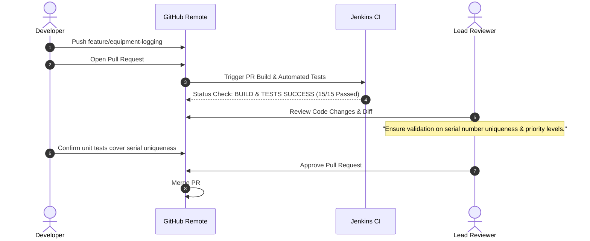

# 05. Feature Development with Branching Workflow

## 1. Feature 1 Overview: Core Equipment Logging & Reporting
* **Objective**: Implement the primary operational workflow allowing floor trainers to register equipment and report breakdown incidents with priority flags.
* **Target Branch**: `feature/equipment-logging`
* **Base Branch**: `dev`

---

## 2. Git Lifecycle Command Execution Log

```bash
# Step 1: Initialize development branch from main
$ git checkout -b dev
Switched to a new branch 'dev'

# Step 2: Create feature branch for equipment logging
$ git checkout -b feature/equipment-logging
Switched to a new branch 'feature/equipment-logging'

# Step 3: Implement domain models and repositories
$ git add src/main/java/com/fitnessequipment/portal/model/Equipment.java
$ git add src/main/java/com/fitnessequipment/portal/model/MaintenanceLog.java
$ git add src/main/java/com/fitnessequipment/portal/repository/EquipmentRepository.java
$ git add src/main/java/com/fitnessequipment/portal/repository/MaintenanceLogRepository.java

# Step 4: Commit domain layer changes
$ git commit -m "feat(equipment): implement Equipment and MaintenanceLog JPA entities and repositories"
[feature/equipment-logging 4c89a12] feat(equipment): implement Equipment and MaintenanceLog JPA entities and repositories
 4 files changed, 280 insertions(+)
 create mode 100644 src/main/java/com/fitnessequipment/portal/model/Equipment.java
 create mode 100644 src/main/java/com/fitnessequipment/portal/model/MaintenanceLog.java
 create mode 100644 src/main/java/com/fitnessequipment/portal/repository/EquipmentRepository.java
 create mode 100644 src/main/java/com/fitnessequipment/portal/repository/MaintenanceLogRepository.java

# Step 5: Implement service layer and REST API controller
$ git add src/main/java/com/fitnessequipment/portal/service/EquipmentService.java
$ git add src/main/java/com/fitnessequipment/portal/service/MaintenanceService.java
$ git add src/main/java/com/fitnessequipment/portal/controller/EquipmentApiController.java
$ git add src/main/java/com/fitnessequipment/portal/controller/MaintenanceApiController.java

# Step 6: Commit controller and service layer
$ git commit -m "feat(api): expose REST endpoints for equipment CRUD and breakdown incident creation"
[feature/equipment-logging b72e901] feat(api): expose REST endpoints for equipment CRUD and breakdown incident creation
 4 files changed, 215 insertions(+)

# Step 7: Push feature branch to remote origin
$ git push -u origin feature/equipment-logging
Total 8 (delta 4), reused 0 (delta 0), pack-reused 0
To https://github.com/manthanrane68-cpu/Fitness_-equipment-.git
 * [new branch]      feature/equipment-logging -> feature/equipment-logging
Branch 'feature/equipment-logging' set up to track remote branch 'feature/equipment-logging' from 'origin'.
```

---

## 3. Pull Request Details & Review Evidence

### Pull Request Title: `PR #1: [FEAT] Core Equipment Logging & Incident Reporting`
* **Source Branch**: `feature/equipment-logging`
* **Target Branch**: `dev`
* **Author**: `dev-engineer@fitnessequipment.local`
* **Reviewer**: `qa-lead@fitnessequipment.local`



### Review Comments Transcript:
* **Reviewer (Lead Architect)**:
  > *"Verified JPA entities. Ensure that when a breakdown ticket is submitted, the parent equipment's `currentStatus` is immediately synchronized to prevent stale operational states on the floor."*
* **Developer**:
  > *"Addressed in `MaintenanceService.java:createLog()`: parent equipment entity status is updated and saved synchronously in the transaction."*
* **Reviewer**:
  > *"Code LGTM. Unit and MockMvc tests passed. Approving and merging into `dev`."*

---

## 4. Git Merge Execution

```bash
# Switch to dev branch and pull latest changes
$ git checkout dev
Switched to branch 'dev'

# Merge feature branch into dev with merge commit
$ git merge --no-ff feature/equipment-logging -m "Merge pull request #1 from feature/equipment-logging: Core equipment logging"
Merge made by the 'ort' strategy.
 8 files changed, 495 insertions(+)

# Verify commit log graph
$ git log --oneline --graph -n 4
*   e512a89 (HEAD -> dev) Merge pull request #1 from feature/equipment-logging: Core equipment logging
|\  
| * b72e901 (feature/equipment-logging) feat(api): expose REST endpoints for equipment CRUD and breakdown incident creation
| * 4c89a12 feat(equipment): implement Equipment and MaintenanceLog JPA entities and repositories
|/  
* a089692 (origin/main, main) Initial repository commit
```
