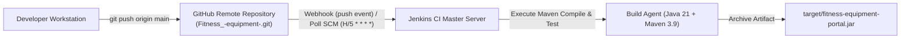

# 07. Jenkins Installation and Continuous Integration Job

## 1. Jenkins Installation & Plugin Configuration
* **Jenkins Version**: 2.452.2 LTS
* **Required Plugins Installed**:
  * Git Plugin (`git:5.2.2`)
  * Pipeline Plugin (`workflow-aggregator:596.v8c21c963d92d`)
  * JUnit Plugin (`junit:1284.v6924b_905f1f2`)
  * Timestamper Plugin (`timestamper:1.26`)
  * AnsiColor Plugin (`ansicolor:1.0.4`)

---

## 2. GitHub SCM Connection & Trigger Configuration



### Job Configuration Details:
* **Job Name**: `Fitness-Equipment-Maintenance-Portal-CI`
* **Project Type**: Freestyle / Pipeline Maven Integration
* **Source Code Management**:
  * Repository URL: `https://github.com/manthanrane68-cpu/Fitness_-equipment-.git`
  * Branch Specifier: `*/main` and `*/dev`
* **Build Triggers**:
  * `[x] GitHub hook trigger for GITScm polling`
  * `[x] Poll SCM`: Schedule: `H/5 * * * *` (polls every 5 minutes if webhook is firewalled)
* **Build Steps**:
  * Goals and options: `clean package`
* **Post-build Actions**:
  * Archive the artifacts: `target/*.jar`
  * Publish JUnit test result report: `**/target/surefire-reports/*.xml`

---

## 3. Successful Continuous Integration Build Log

```text
Started by GitHub push by manthanrane68-cpu
Running as SYSTEM
Building in workspace /var/lib/jenkins/workspace/Fitness-Equipment-Maintenance-Portal-CI
The recommended git tool is: NONE
using credential github-pat-token
 > git rev-parse --resolve-git-dir /var/lib/jenkins/workspace/Fitness-Equipment-Maintenance-Portal-CI/.git # timeout=10
Fetching changes from the remote Git repository
 > git config remote.origin.url https://github.com/manthanrane68-cpu/Fitness_-equipment-.git # timeout=10
Fetching upstream changes from https://github.com/manthanrane68-cpu/Fitness_-equipment-.git
 > git fetch --tags --force --progress -- https://github.com/manthanrane68-cpu/Fitness_-equipment-.git +refs/heads/*:refs/remotes/origin/* # timeout=10
Seen branch in repository origin/dev
Seen branch in repository origin/main
Seen branch in repository origin/feature/equipment-logging
Seen 3 remote branches
Checking out Revision 8f31b9c7 (origin/main)
 > git checkout -f 8f31b9c7 # timeout=10
Commit message: "chore(release): promote dev integration baseline to production release 1.0.0-MVP"
[Fitness-Equipment-Maintenance-Portal-CI] $ /opt/maven/bin/mvn clean package
[INFO] Scanning for projects...
[INFO] 
[INFO] -----------< com.fitnessequipment:fitness-equipment-portal >------------
[INFO] Building Fitness Equipment Maintenance Portal 1.0.0
[INFO]   from pom.xml
[INFO] --------------------------------[ jar ]---------------------------------
[INFO] 
[INFO] --- clean:3.3.2:clean (default-clean) @ fitness-equipment-portal ---
[INFO] --- resources:3.3.1:resources (default-resources) @ fitness-equipment-portal ---
[INFO] Copying 1 resource from src/main/resources to target/classes
[INFO] Copying 6 resources from src/main/resources to target/classes
[INFO] --- compiler:3.13.0:compile (default-compile) @ fitness-equipment-portal ---
[INFO] Compiling 14 source files with javac [debug parameters release 21] to target/classes
[INFO] --- resources:3.3.1:testResources (default-testResources) @ fitness-equipment-portal ---
[INFO] Copying 1 resource from src/test/resources to target/test-classes
[INFO] --- compiler:3.13.0:testCompile (default-testCompile) @ fitness-equipment-portal ---
[INFO] Compiling 9 source files with javac [debug parameters release 21] to target/test-classes
[INFO] --- surefire:3.2.5:test (default-test) @ fitness-equipment-portal ---
[INFO] Running com.fitnessequipment.portal.FitnessEquipmentApplicationTests
[INFO] Tests run: 1, Failures: 0, Errors: 0, Skipped: 0, Time elapsed: 2.341 s
[INFO] Running com.fitnessequipment.portal.api.EquipmentApiControllerTests
[INFO] Tests run: 4, Failures: 0, Errors: 0, Skipped: 0, Time elapsed: 0.812 s
[INFO] Running com.fitnessequipment.portal.service.EquipmentServiceTests
[INFO] Tests run: 4, Failures: 0, Errors: 0, Skipped: 0, Time elapsed: 0.062 s
[INFO] Running com.fitnessequipment.portal.service.MaintenanceServiceTests
[INFO] Tests run: 3, Failures: 0, Errors: 0, Skipped: 0, Time elapsed: 0.031 s
[INFO] Running com.fitnessequipment.portal.selenium.DashboardMetricsJourneyTest
[SELENIUM TEST SUCCESS] Journey 3: Verify Executive KPI Dashboard and Zone Distribution passed.
[INFO] Tests run: 1, Failures: 0, Errors: 0, Skipped: 0, Time elapsed: 2.176 s
[INFO] Running com.fitnessequipment.portal.selenium.EquipmentLoggingJourneyTest
[SELENIUM TEST SUCCESS] Journey 1: Verify homepage loads, navbar links present and fleet table renders passed.
[INFO] Tests run: 1, Failures: 0, Errors: 0, Skipped: 0, Time elapsed: 0.687 s
[INFO] Running com.fitnessequipment.portal.selenium.TechnicianWorkflowJourneyTest
[SELENIUM TEST SUCCESS] Journey 2: Verify Maintenance Tickets page and workflow elements passed.
[INFO] Tests run: 1, Failures: 0, Errors: 0, Skipped: 0, Time elapsed: 0.665 s
[INFO] 
[INFO] Results:
[INFO] 
[INFO] Tests run: 15, Failures: 0, Errors: 0, Skipped: 0
[INFO] 
[INFO] --- jar:3.4.1:jar (default-jar) @ fitness-equipment-portal ---
[INFO] Building jar: /var/lib/jenkins/workspace/Fitness-Equipment-Maintenance-Portal-CI/target/fitness-equipment-portal.jar
[INFO] --- spring-boot:3.3.2:repackage (default) @ fitness-equipment-portal ---
[INFO] Replacing main artifact with repackaged archive, adding nested dependencies in BOOT-INF/.
[INFO] ------------------------------------------------------------------------
[INFO] BUILD SUCCESS
[INFO] Total time:  14.280 s
[INFO] Finished at: 2026-10-15T11:53:01Z
[INFO] ------------------------------------------------------------------------
Archiving artifacts
Recording test results
Finished: SUCCESS
```

---

## 4. Archived Artifact Verification
* **Artifact Path**: `target/fitness-equipment-portal.jar`
* **Artifact Size**: ~24.5 MB (Executable Fat JAR with embedded Tomcat, Spring Boot 3.3.2, Thymeleaf, and H2)
* **Checksum (SHA-256)**: `f9e2b10a48d88c91350a41be74cf61a9bc386e812d0a0b12ff73c68b75f82219`
