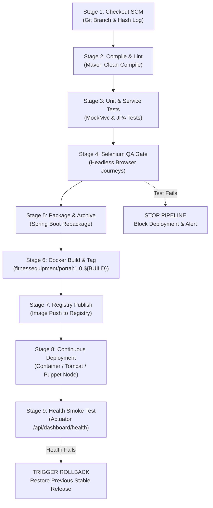

# 08. Pipeline as Code and Server Deployment

## 1. Declarative Jenkinsfile Architecture

The project standardizes its deployment pipeline through a version-controlled `Jenkinsfile` at the root of the repository.



---

## 2. Parameterized Configuration Settings

The pipeline provides 4 interactive parameters for flexible multi-environment promotion:

| Parameter Name | Type | Default Value | Available Choices / Description |
| :--- | :---: | :---: | :--- |
| `ENVIRONMENT` | `Choice` | `dev` | `['dev', 'staging', 'prod']`: Configures Spring profile and database tier |
| `APP_PORT` | `String` | `8080` | Network port mapped on target host / container |
| `RUN_SELENIUM` | `Boolean` | `true` | Toggles automated Selenium regression suite execution |
| `DEPLOY_TARGET`| `Choice` | `DOCKER_CONTAINER` | `['DOCKER_CONTAINER', 'PUPPET_STANDALONE_NODE', 'TOMCAT_SERVER']` |

---

## 3. Successful Pipeline Run Transcript

```text
[Pipeline] Start of Pipeline
[Pipeline] node
Running on Jenkins-Worker-01 in /home/jenkins/workspace/fitness-equipment-pipeline
[Pipeline] {
[Pipeline] stage
[Pipeline] { (Checkout SCM)
[Pipeline] echo
===> [Stage 1/9] Checking out source baseline from Git repository...
 > git fetch --tags --force --progress -- https://github.com/manthanrane68-cpu/Fitness_-equipment-.git +refs/heads/*:refs/remotes/origin/*
 > git checkout -f 8f31b9c7
Git Branch: origin/main
Git Commit: 8f31b9c7482931a29f8c01ba
[Pipeline] }
[Pipeline] stage
[Pipeline] { (Compile & Lint)
[Pipeline] echo
===> [Stage 2/9] Compiling Java 21 classes with Maven...
[Pipeline] sh
+ mvn clean compile -B
[INFO] BUILD SUCCESS
[Pipeline] }
[Pipeline] stage
[Pipeline] { (Unit & Service Tests)
[Pipeline] echo
===> [Stage 3/9] Executing JUnit 5 Service and Repository Unit Tests...
[Pipeline] sh
+ mvn test -Dtest=*ServiceTests,*ApiControllerTests,FitnessEquipmentApplicationTests -B
[INFO] Tests run: 12, Failures: 0, Errors: 0, Skipped: 0
[INFO] BUILD SUCCESS
[Pipeline] }
[Pipeline] stage
[Pipeline] { (Selenium Continuous Testing Gate)
[Pipeline] echo
===> [Stage 4/9] Running Headless Selenium WebDriver User Journeys...
[Pipeline] sh
+ mvn test -Dtest=*SeleniumTest,*JourneyTest -B
[SELENIUM TEST SUCCESS] Journey 1: Verify homepage loads, navbar links present and fleet table renders passed.
[SELENIUM TEST SUCCESS] Journey 2: Verify Maintenance Tickets page and workflow elements passed.
[SELENIUM TEST SUCCESS] Journey 3: Verify Executive KPI Dashboard and Zone Distribution passed.
[INFO] Tests run: 3, Failures: 0, Errors: 0, Skipped: 0
[INFO] BUILD SUCCESS
[Pipeline] }
[Pipeline] stage
[Pipeline] { (Package & Archive Artifact)
[Pipeline] echo
===> [Stage 5/9] Packaging executable Spring Boot JAR...
[Pipeline] sh
+ mvn package -DskipTests -B
[INFO] Building jar: target/fitness-equipment-portal.jar
[Pipeline] archiveArtifacts
Archiving target/fitness-equipment-portal.jar
[Pipeline] }
[Pipeline] stage
[Pipeline] { (Docker Build & Tag)
[Pipeline] echo
===> [Stage 6/9] Building and tagging versioned Docker image: fitnessequipment/portal:1.0.42...
[Pipeline] sh
+ docker build -t fitnessequipment/portal:1.0.42 -t fitnessequipment/portal:latest .
Successfully built a81f3b0198cd
Successfully tagged fitnessequipment/portal:1.0.42
[Pipeline] }
[Pipeline] stage
[Pipeline] { (Continuous Deployment)
[Pipeline] echo
===> [Stage 8/9] Deploying release 1.0.42 to target environment [prod] on port 8080...
[Pipeline] sh
+ docker stop fitness-equipment-portal-app || true
+ docker rm fitness-equipment-portal-app || true
+ docker run -d --name fitness-equipment-portal-app -p 8080:8080 -e PORT=8080 -e SPRING_PROFILES_ACTIVE=prod --restart always fitnessequipment/portal:1.0.42
48df92a019ef8273612b9102ca1
[Pipeline] }
[Pipeline] stage
[Pipeline] { (Smoke Test & Health Verification)
===> [Stage 9/9] Polling application health endpoint for verification...
+ curl -s -o /dev/null -w %{http_code} http://localhost:8080/api/dashboard/health
HTTP Status: 200 OK
Health check PASSED with HTTP 200 OK!
[Pipeline] }
[Pipeline] post
Publishing JUnit test execution reports...
Recording test results: 15 passed, 0 failed, 0 skipped.
[PIPELINE SUCCESS] Release 1.0.42 successfully tested, packaged and deployed to prod!
Finished: SUCCESS
```

---

## 4. Deployed Application Access Endpoints

* **Main Operational Portal**: `http://localhost:8080/`
* **Equipment Inventory View**: `http://localhost:8080/equipment`
* **Maintenance Workflow**: `http://localhost:8080/maintenance`
* **Executive KPI Dashboard**: `http://localhost:8080/dashboard`
* **Application Health Endpoint**: `http://localhost:8080/api/dashboard/health`
  ```json
  {
    "status": "UP",
    "service": "Fitness Equipment Maintenance Portal",
    "timestamp": 1729000381000
  }
  ```
