# 09. Selenium Test Design and Local Execution

## 1. Selenium Automated Test Plan

The Selenium automation suite validates critical end-user journeys from the perspective of real gym staff and management personas using headless browser automation.

```mermaid
flowchart TD
    subgraph Journey1["Journey 1: Operations Overview & Fleet Inspection"]
        J1_1["Navigate to Homepage /"] --> J1_2["Verify Document Title & Brand"]
        J1_2 --> J1_3["Verify KPI Fleet & Breakdown Metric Cards"]
        J1_3 --> J1_4["Verify 'Report Breakdown' & 'Add Equipment' Modals"]
    end

    subgraph Journey2["Journey 2: Technician Workflow Progression"]
        J2_1["Navigate to /maintenance"] --> J2_2["Verify Work Order Header"]
        J2_2 --> J2_3["Verify Active Seed Tickets Rendered in DOM"]
        J2_3 --> J2_4["Verify Workflow Status Badges"]
    end

    subgraph Journey3["Journey 3: Executive Analytics & Distribution"]
        J3_1["Navigate to /dashboard"] --> J3_2["Verify Executive Title"]
        J3_2 --> J3_3["Assert >= 5 Metric Cards Visible"]
        J3_3 --> J3_4["Verify Fleet Distribution by Gym Zone Table"]
    end
```



---

## 2. Test Suite Architecture & Implementation Details

* **Framework Stack**: Selenium WebDriver 4.23.0, WebDriverManager 5.9.2, JUnit 5 (Jupiter), Spring Boot Test (Random Port).
* **Execution Engine**: Headless Chrome with `--headless=new`, `--no-sandbox`, `--disable-dev-shm-usage`, and 1080p viewport.
* **Driver Synchronization**: Implements explicit `WebDriverWait` with `ExpectedConditions` to guarantee DOM stability regardless of network latency.

### Class Structure:
1. `BaseSeleniumTest.java`: Handles browser lifecycle, random server port injection, explicit wait helper methods (`waitForElement`, `waitForTitle`), and teardown.
2. `TestScreenshotWatcher.java`: JUnit 5 `TestWatcher` callback that automatically intercepts test failure events and captures a PNG screenshot to `target/screenshots/`.
3. `EquipmentLoggingJourneyTest.java`: Tests Journey 1 (Homepage & fleet table).
4. `TechnicianWorkflowJourneyTest.java`: Tests Journey 2 (Maintenance tickets & badges).
5. `DashboardMetricsJourneyTest.java`: Tests Journey 3 (Executive metrics & zone cards).

---

## 3. Failure Screenshot Mechanism (`TestScreenshotWatcher`)

When any assertion or timeout exception is thrown during test execution, the `testFailed()` extension automatically captures the full viewport and saves it with a structured timestamp:

```java
@Override
public void testFailed(ExtensionContext context, Throwable cause) {
    if (driver != null && driver instanceof TakesScreenshot) {
        String timestamp = LocalDateTime.now().format(DateTimeFormatter.ofPattern("yyyyMMdd_HHmmss"));
        String testName = context.getRequiredTestClass().getSimpleName() + "_" +
                          context.getRequiredTestMethod().getName();
        File screenshotFile = new File("target/screenshots/" + testName + "_" + timestamp + "_FAILED.png");
        byte[] bytes = ((TakesScreenshot) driver).getScreenshotAs(OutputType.BYTES);
        Files.write(screenshotFile.toPath(), bytes);
    }
}
```

---

## 4. Local Test Execution Log via Maven

```bash
$ mvn test -Dtest=*SeleniumTest,*JourneyTest
[INFO] Scanning for projects...
[INFO] 
[INFO] -----------< com.fitnessequipment:fitness-equipment-portal >------------
[INFO] Building Fitness Equipment Maintenance Portal 1.0.0
[INFO]   from pom.xml
[INFO] --------------------------------[ jar ]---------------------------------
[INFO] 
[INFO] --- surefire:3.2.5:test (default-test) @ fitness-equipment-portal ---
[INFO] Running com.fitnessequipment.portal.selenium.DashboardMetricsJourneyTest
[SELENIUM TEST SUCCESS] Journey 3: Verify Executive KPI Dashboard and Zone Distribution passed.
[INFO] Tests run: 1, Failures: 0, Errors: 0, Skipped: 0, Time elapsed: 2.176 s -- in com.fitnessequipment.portal.selenium.DashboardMetricsJourneyTest
[INFO] Running com.fitnessequipment.portal.selenium.EquipmentLoggingJourneyTest
[SELENIUM TEST SUCCESS] Journey 1: Verify homepage loads, navbar links present and fleet table renders passed.
[INFO] Tests run: 1, Failures: 0, Errors: 0, Skipped: 0, Time elapsed: 0.687 s -- in com.fitnessequipment.portal.selenium.EquipmentLoggingJourneyTest
[INFO] Running com.fitnessequipment.portal.selenium.TechnicianWorkflowJourneyTest
[SELENIUM TEST SUCCESS] Journey 2: Verify Maintenance Tickets page and workflow elements passed.
[INFO] Tests run: 1, Failures: 0, Errors: 0, Skipped: 0, Time elapsed: 0.665 s -- in com.fitnessequipment.portal.selenium.TechnicianWorkflowJourneyTest
[INFO] 
[INFO] Results:
[INFO] 
[INFO] Tests run: 3, Failures: 0, Errors: 0, Skipped: 0
[INFO] 
[INFO] ------------------------------------------------------------------------
[INFO] BUILD SUCCESS
[INFO] Total time:  6.418 s
[INFO] ------------------------------------------------------------------------
```
