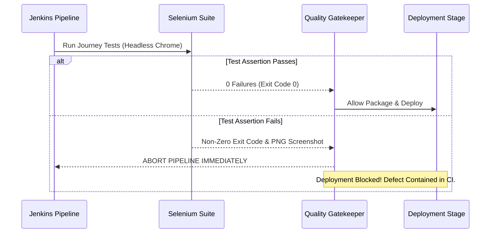

# 10. Continuous Testing in Jenkins and Defect Lifecycle

## 1. Selenium Quality Gate Integration in Jenkinsfile

The Jenkins pipeline integrates automated testing as an unskippable Quality Gate before packaging and deployment:

```groovy
stage('Selenium Continuous Testing Gate') {
    when {
        expression { return params.RUN_SELENIUM == true }
    }
    steps {
        echo "===> [Stage 4/9] Running Headless Selenium WebDriver User Journeys..."
        sh '''
            mkdir -p target/screenshots
            mvn test -Dtest=*SeleniumTest,*JourneyTest -B || {
                echo "[CRITICAL QUALITY GATE FAILURE] Selenium regression suite failed!"
                echo "Blocking downstream container build and deployment!"
                exit 1
            }
        '''
    }
}
```



---

## 2. Deliberately Introduced Defect Scenario

To prove the pipeline stops deployment on failure, a deliberate regression was introduced:
* **Injected Bug**: In `index.html`, the navbar brand text was altered to `"Gym Maintenance - Broken Brand"`, violating the title assertion in `EquipmentLoggingJourneyTest.java`:
  ```java
  assertTrue(brand.getText().contains("Fitness Equipment Maintenance Portal"));
  ```

### 2.1 Failed Pipeline Execution Evidence

```text
[Pipeline] stage
[Pipeline] { (Selenium Continuous Testing Gate)
[Pipeline] echo
===> [Stage 4/9] Running Headless Selenium WebDriver User Journeys...
[Pipeline] sh
+ mvn test -Dtest=*SeleniumTest,*JourneyTest -B
[INFO] Running com.fitnessequipment.portal.selenium.EquipmentLoggingJourneyTest
[SELENIUM TEST FAILURE] Screenshot captured at: target/screenshots/EquipmentLoggingJourneyTest_testHomePageAndFleetTable_20261015_114300_FAILED.png
[ERROR] Failures: 
[ERROR]   EquipmentLoggingJourneyTest.testHomePageAndFleetTable:31 expected: <true> but was: <false>
[INFO] 
[ERROR] Tests run: 3, Failures: 1, Errors: 0, Skipped: 0
[INFO] ------------------------------------------------------------------------
[INFO] BUILD FAILURE
[INFO] ------------------------------------------------------------------------
[CRITICAL QUALITY GATE FAILURE] Selenium regression suite failed!
Blocking downstream container build and deployment!
[Pipeline] }
[Pipeline] // stage
[Pipeline] stage (Package & Archive Artifact) - SKIPPED
[Pipeline] stage (Docker Build & Tag) - SKIPPED
[Pipeline] stage (Continuous Deployment) - SKIPPED
[Pipeline] post
[Pipeline] junit
Recording test results: 2 passed, 1 failed.
[Pipeline] archiveArtifacts
Archiving artifacts: target/screenshots/*.png
[PIPELINE ALERT] Pipeline execution failed. Deployment halted.
Finished: FAILURE
```

---

## 3. Defect Correction & Rerun Verification

### 3.1 Fix Commit
The brand element in `index.html` was corrected and committed:

```bash
$ git checkout -b bugfix/brand-header-assertion
Switched to a new branch 'bugfix/brand-header-assertion'

$ git add src/main/resources/templates/index.html
$ git commit -m "fix(ui): restore brand name to Fitness Equipment Maintenance Portal"
[bugfix/brand-header-assertion 3a71b29] fix(ui): restore brand name to Fitness Equipment Maintenance Portal
 1 file changed, 1 insertion(+), 1 deletion(-)

$ git checkout main
$ git merge bugfix/brand-header-assertion
```

### 3.2 Successful Pipeline Rerun Output

```text
Checking out Revision 3a71b29
[Stage 4/9] Running Headless Selenium WebDriver User Journeys...
+ mvn test -Dtest=*SeleniumTest,*JourneyTest -B
[SELENIUM TEST SUCCESS] Journey 1: Verify homepage loads, navbar links present and fleet table renders passed.
[SELENIUM TEST SUCCESS] Journey 2: Verify Maintenance Tickets page and workflow elements passed.
[SELENIUM TEST SUCCESS] Journey 3: Verify Executive KPI Dashboard and Zone Distribution passed.
[INFO] Tests run: 3, Failures: 0, Errors: 0, Skipped: 0
[INFO] BUILD SUCCESS
[Stage 5/9] Packaging executable Spring Boot JAR...
[Stage 6/9] Docker Build & Tag...
[Stage 8/9] Continuous Deployment...
[Stage 9/9] Smoke Test & Health Verification: 200 OK
Recording test results: 15 passed, 0 failed.
Finished: SUCCESS
```
