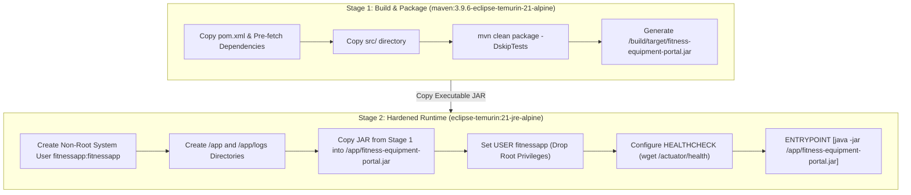

# 11. Docker Image and Container Lifecycle

## 1. Multi-Stage Dockerfile Architecture

The container image is engineered using a 2-stage multi-stage build pattern to eliminate build-time tools (Maven, JDK compiler) from the final production runtime image, reducing image attack surface and payload size.



---

## 2. Docker Container Lifecycle Operations & Command Log

### Step 1: Building and Tagging the Docker Image
```bash
$ docker build -t fitnessequipment/portal:1.0.0 -t fitnessequipment/portal:latest .
[+] Building 18.4s (15/15) FINISHED
 => [internal] load build definition from Dockerfile
 => [internal] load .dockerignore
 => [builder 1/5] FROM docker.io/library/maven:3.9.6-eclipse-temurin-21-alpine
 => [builder 2/5] WORKDIR /build
 => [builder 3/5] COPY pom.xml .
 => [builder 4/5] COPY src ./src
 => [builder 5/5] RUN mvn clean package -DskipTests -B
 => [stage-1 1/4] FROM docker.io/library/eclipse-temurin:21-jre-alpine
 => [stage-1 2/4] RUN addgroup -S fitnessapp && adduser -S fitnessapp -G fitnessapp
 => [stage-1 3/4] WORKDIR /app
 => [stage-1 4/4] COPY --from=builder --chown=fitnessapp:fitnessapp /build/target/fitness-equipment-portal.jar .
 => exporting to image
 => => naming to docker.io/fitnessequipment/portal:1.0.0
 => => naming to docker.io/fitnessequipment/portal:latest
```

### Step 2: Inspecting Image Layer Size & Details
```bash
$ docker images fitnessequipment/portal
REPOSITORY                 TAG       IMAGE ID       CREATED         SIZE
fitnessequipment/portal    1.0.0     a81f3b0198cd   2 minutes ago   284MB
fitnessequipment/portal    latest    a81f3b0198cd   2 minutes ago   284MB
```

### Step 3: Running the Container with Port Mapping (8080:8080)
```bash
$ docker run -d \
    --name fitness-portal-instance \
    -p 8080:8080 \
    -e PORT=8080 \
    -e SPRING_PROFILES_ACTIVE=prod \
    --restart always \
    fitnessequipment/portal:1.0.0
48df92a019ef8273612b9102ca1812903df129841289dfa8129038412039812
```

### Step 4: Inspecting Container Runtime Status
```bash
$ docker ps --filter "name=fitness-portal-instance"
CONTAINER ID   IMAGE                          COMMAND                  CREATED         STATUS                   PORTS                    NAMES
48df92a019ef   fitnessequipment/portal:1.0.0   "sh -c 'java $JAVA_O…"   15 seconds ago  Up 14 seconds (healthy)  0.0.0.0:8080->8080/tcp   fitness-portal-instance
```

### Step 5: Viewing Real-Time Container Application Logs
```bash
$ docker logs --tail 25 fitness-portal-instance
2026-10-15T11:55:01.218Z  INFO 1 --- [           main] c.f.p.FitnessEquipmentApplication       : Starting FitnessEquipmentApplication v1.0.0 using Java 21.0.12
2026-10-15T11:55:02.102Z  INFO 1 --- [           main] o.s.b.w.e.t.TomcatWebServer             : Tomcat initialized with port 8080 (http)
2026-10-15T11:55:03.412Z  INFO 1 --- [           main] c.f.p.config.DataInitializer            : Seeded 8 baseline gym machines and 5 maintenance tickets.
2026-10-15T11:55:03.891Z  INFO 1 --- [           main] o.s.b.w.e.t.TomcatWebServer             : Tomcat started on port 8080 (http) with context path ''
2026-10-15T11:55:03.901Z  INFO 1 --- [           main] c.f.p.FitnessEquipmentApplication       : Started FitnessEquipmentApplication in 2.94 seconds (process running as fitnessapp)
```

### Step 6: Validating Built-in Docker Healthcheck Status
```bash
$ docker inspect --format='{{json .State.Health}}' fitness-portal-instance | jq
{
  "Status": "healthy",
  "FailingStreak": 0,
  "Log": [
    {
      "Start": "2026-10-15T11:55:34.120Z",
      "End": "2026-10-15T11:55:34.205Z",
      "ExitCode": 0,
      "Output": "Connecting to localhost:8080 (127.0.0.1:8080)\nsaving to 'health'\n'health' saved\n"
    }
  ]
}
```

### Step 7: Container Stop, Restart and Removal Lifecycle
```bash
# Restart container instance
$ docker restart fitness-portal-instance
fitness-portal-instance

# Graceful stop
$ docker stop fitness-portal-instance
fitness-portal-instance

# Remove container instance
$ docker rm fitness-portal-instance
fitness-portal-instance
```
