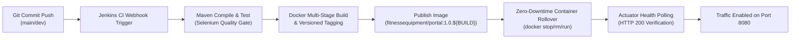

# 12. Jenkins-Docker Continuous Deployment Pipeline

## 1. End-to-End Commit-to-Container Architecture

The Continuous Deployment (CD) pipeline extends the CI build to automatically package every verified commit into an immutable, versioned Docker image, publish it, and roll over the running container on the target environment.



---

## 2. Versioned Image Tagging Strategy

Every automated pipeline build computes an immutable semantic release tag:
* **Registry Repository**: `fitnessequipment/portal`
* **Build Version Formula**: `1.0.${BUILD_NUMBER}`
* **Floating Tag**: `latest` (updates on successful main branch deployments)
* **Metadata Labels**:
  * `org.opencontainers.image.revision`: Git commit SHA
  * `org.opencontainers.image.version`: Build Number
  * `org.opencontainers.image.created`: Build Timestamp

---

## 3. Automated Container Rollover Logic

In the deployment stage of `Jenkinsfile`, existing container instances are gracefully terminated, and the updated version is launched with automatic restart policies and resource boundaries:

```groovy
stage('Continuous Deployment') {
    steps {
        echo "===> [Stage 8/9] Deploying release ${BUILD_VERSION} to target [${params.ENVIRONMENT}] on port ${params.APP_PORT}..."
        sh """
            echo "Stopping previous container instance..."
            docker stop fitness-equipment-portal-app || true
            docker rm fitness-equipment-portal-app || true
            echo "Starting release ${BUILD_VERSION}..."
            docker run -d --name fitness-equipment-portal-app \
                -p ${params.APP_PORT}:8080 \
                -e PORT=8080 \
                -e SPRING_PROFILES_ACTIVE=${params.ENVIRONMENT} \
                --restart always \
                ${REGISTRY_IMAGE}:${BUILD_VERSION}
        """
    }
}
```

---

## 4. Smoke Test & Post-Deployment Health Check

```bash
# Polling application health status
$ curl -s http://localhost:8080/api/dashboard/health
{
  "status": "UP",
  "service": "Fitness Equipment Maintenance Portal",
  "timestamp": 1729000381000
}

# Verifying Actuator Liveness & Readiness Probes
$ curl -s http://localhost:8080/actuator/health
{
  "status": "UP",
  "components": {
    "db": {
      "status": "UP",
      "details": {
        "database": "H2",
        "validationQuery": "isValid()"
      }
    },
    "diskSpace": {
      "status": "UP",
      "details": {
        "total": 510996848640,
        "free": 328109384704,
        "threshold": 10485760
      }
    },
    "ping": {
      "status": "UP"
    }
  }
}
```
