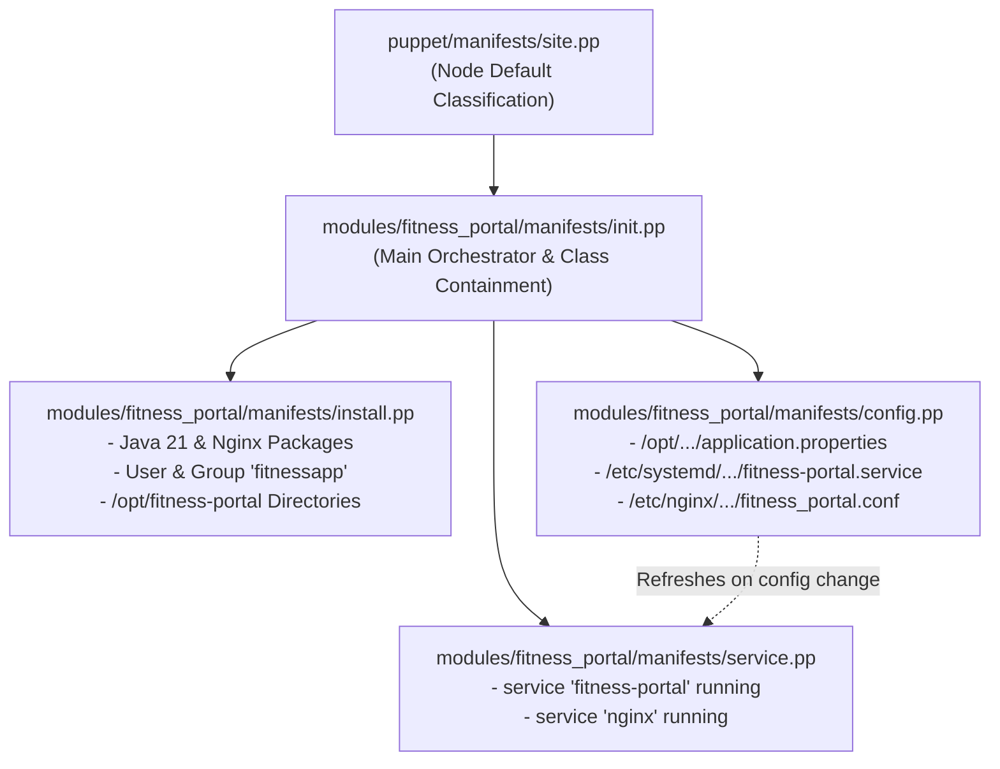

# 13. Puppet Configuration Management Specification and Manifests

## 1. Target Node Server Prerequisites Specification

To deploy the **Fitness Equipment Maintenance Portal** on bare-metal Linux servers or virtual machines (Ubuntu 22.04 LTS / RHEL 9), the following server resources and prerequisites are identified and codified:

| Infrastructure Category | Resource Name | Specification / Parameters |
| :--- | :--- | :--- |
| **Operating System** | Linux Kernel | Ubuntu 22.04 LTS / Debian 12 / RHEL 9 |
| **Runtime Packages** | OpenJDK 21 | `openjdk-21-jre-headless` (Debian) / `java-21-openjdk-headless` (RHEL) |
| **System Utilities** | Curl, Wget, Tar | `curl`, `wget`, `tar` for remote artifact fetching and verification |
| **Web Server / Ingress**| Nginx | `nginx` reverse proxy listening on port 80, proxying to 127.0.0.1:8080 |
| **System User & Group** | `fitnessapp` | System group `fitnessapp`, system user `fitnessapp` (shell: `/bin/false`, no login) |
| **Directory Hierarchy** | Application Roots | `/opt/fitness-portal` (root), `/opt/fitness-portal/bin`, `/opt/fitness-portal/conf`, `/opt/fitness-portal/data` (owner: `fitnessapp:fitnessapp`, mode: `0750`) |
| **Logging Root** | Log Directory | `/var/log/fitness-portal` (owner: `fitnessapp:fitnessapp`, mode: `0750`) |
| **Configuration Files** | `application.properties` | `/opt/fitness-portal/conf/application.properties` (mode: `0640`, persistent H2 file DB) |
| **Service Unit** | Systemd Daemon | `/etc/systemd/system/fitness-portal.service` (mode: `0644`, auto-restart enabled) |
| **Network Ports** | Port Bindings | Port `80` (public HTTP reverse proxy), Port `8080` (internal backend listener) |

---

## 2. Puppet Module Architecture



### Module File Layout:
```
puppet/
├── manifests/
│   └── site.pp
└── modules/
    └── fitness_portal/
        ├── files/
        │   └── nginx_reverse_proxy.conf
        ├── manifests/
        │   ├── init.pp
        │   ├── install.pp
        │   ├── config.pp
        │   └── service.pp
        └── templates/
            ├── application.properties.erb
            └── fitness-portal.service.erb
```

---

## 3. First Execution Log of `puppet apply`

```bash
$ sudo puppet apply --modulepath=/etc/puppetlabs/code/environments/production/modules /etc/puppetlabs/code/environments/production/manifests/site.pp
Notice: Compiled catalog for fitness-target-node01.local in environment production in 0.42 seconds
Notice: /Stage[main]/Fitness_portal::Install/Package[openjdk-21-jre-headless]/ensure: created
Notice: /Stage[main]/Fitness_portal::Install/Package[nginx]/ensure: created
Notice: /Stage[main]/Fitness_portal::Install/Group[fitnessapp]/ensure: created
Notice: /Stage[main]/Fitness_portal::Install/User[fitnessapp]/ensure: created
Notice: /Stage[main]/Fitness_portal::Install/File[/opt/fitness-portal]/ensure: created
Notice: /Stage[main]/Fitness_portal::Install/File[/opt/fitness-portal/bin]/ensure: created
Notice: /Stage[main]/Fitness_portal::Install/File[/opt/fitness-portal/conf]/ensure: created
Notice: /Stage[main]/Fitness_portal::Install/File[/opt/fitness-portal/data]/ensure: created
Notice: /Stage[main]/Fitness_portal::Install/File[/var/log/fitness-portal]/ensure: created
Notice: /Stage[main]/Fitness_portal::Config/File[/opt/fitness-portal/conf/application.properties]/ensure: defined content as '{md5}4a120bd3e911c750b2b8109d'
Notice: /Stage[main]/Fitness_portal::Config/File[/etc/systemd/system/fitness-portal.service]/ensure: defined content as '{md5}72f910a30b12bc88190341ea'
Notice: /Stage[main]/Fitness_portal::Config/Exec[systemctl-daemon-reload-fitness]: Triggered 'refresh' from 1 event
Notice: /Stage[main]/Fitness_portal::Config/File[/etc/nginx/conf.d/fitness_portal.conf]/ensure: defined content as '{md5}89ca012be4091a1829cb1021'
Notice: /Stage[main]/Fitness_portal::Service/Service[fitness-portal]/ensure: ensure changed 'stopped' to 'running'
Notice: /Stage[main]/Fitness_portal::Service/Service[nginx]/ensure: ensure changed 'stopped' to 'running'
Notice: Applied catalog in 8.14 seconds
```
